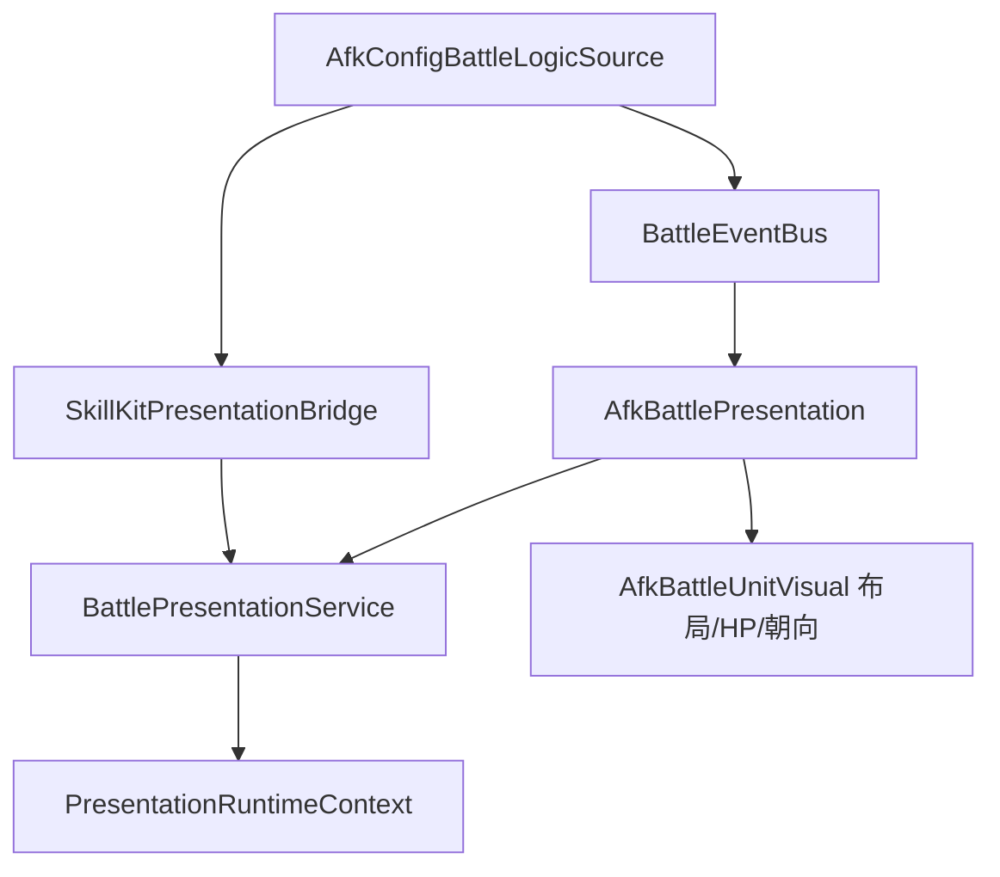

# AFK 战斗表现 × HotUpdate Framework 接入分析

> 版本 v1.0 · 2026-07-24  
> 范围：AFK 试玩战斗链路（SkillKit 逻辑 + 2D 灰盒表现）如何迁移到 Framework Presentation 层。  
> **本阶段：深入分析 + Phase 0 接入方案，不含美术资产替换。**

---

## 1. 结论摘要

| 维度 | 现状 | 目标 |
|------|------|------|
| 战斗逻辑 | SkillKit `AfkConfigBattleLogicSource` → `BattleEventBus` | 保持不变 |
| 主表现层 | `AfkBattlePresentation` + `AfkBattleUnitVisual`（程序生成 Quad） | 保留布局/HP/朝向，VFX/SFX/Sequence 走 Framework |
| 重复订阅 | `BattleViewRoot` / `UnitView` 与 AFK 层 **双路** 监听同一 EventBus | Phase 0 去重，只留一条表现路径 |
| Framework 能力 | `BattlePresentationService` + `SkillKitPresentationBridge` **已实现但未实例化** | 每场战斗创建 Service + Bridge |
| 时钟/加速 | `BattleController.SetBattleSpeed` 仅驱动逻辑 | 同步 `BattlePresentationService.SetTimeScale` |

**推荐策略：分 4 阶段渐进迁移，Phase 0 可在不改美术的前提下消除重复、打通 Framework 生命周期。**

---

## 2. 当前架构（As-Is）

```mermaid
flowchart TB
    subgraph Logic
        BC[BattleController]
        Logic[AfkConfigBattleLogicSource]
        Bus[BattleEventBus]
        BC --> Logic
        Logic --> Bus
    end

    subgraph Presentation_Duplicate
        BVR[BattleViewRoot]
        UV[UnitView x N]
        ABP[AfkBattlePresentation]
        ABV[AfkBattleUnitVisual x N]
    end

    subgraph Unused
        BPS[BattlePresentationService]
        SKB[SkillKitPresentationBridge]
        SPD[SkillPresentationDirector]
    end

    Bus --> BVR
    Bus --> ABP
    BVR --> UV
    ABP --> ABV
    Logic -.-> SPD
    SPD -.-> SKB
    SKB -.-> BPS
```

### 2.1 逻辑层（稳定，无需大改）

- 入口：`AfkGamePlayHost.StartBattleLocal` 组装 `BattleContext`（Model / Timeline / EventBus / LogicSource）。
- 驱动：`BattleController.Init` → 固定 tick；`AfkConfigBattleLogicSource` 发布 `SkillCastBeginEvent`、`SkillHitEvent`、`UnitDieEvent` 等。
- SkillKit Presentation 时间线：`SkillPresentationDirector` 在逻辑侧 tick，但 AFK host **未注入** `ISkillPresentationHost`，目前 cue 仅 log。

### 2.2 表现层 A — `BattleViewRoot`（Legacy 3D 占位）

路径：`Game/Battle/View/BattleViewRoot.cs`

- `BuildScene` 为每个 `UnitModel` 创建 `UnitView` GameObject。
- 订阅 EventBus：`PlayCast` / `PlayHit` / `PlayDie` + `DamageTextPlayer` 飘字。
- AFK 2D 层在 `AfkBattlePresentation.SyncVisuals` 复用 **同一** `UnitView.transform` 挂载 `AfkBattleUnitVisual`。

**问题：** 同一事件被 `BattleViewRoot` 与 `AfkBattlePresentation` 各处理一次 → 重复动画/飘字/死亡协程风险。

### 2.3 表现层 B — `AfkBattlePresentation`（AFK 灰盒）

路径：`Game/Afk/Battle/AfkBattlePresentation.cs`

- 职责：2D 侧视场地（`AfkBattleArenaPresenter`）、单位 Quad 精灵、HP 条、朝向、程序化 hit/heal/die burst。
- 每帧 `SyncPositionsFromLogic` 从逻辑坐标写回世界坐标。
- **未使用** `PresentationRuntimeContext`、`BattlePresentationService`、`AudioManager`。

### 2.4 Framework 层（已就绪，AFK 未接）

| 类 | 路径 | 能力 |
|----|------|------|
| `PresentationRuntimeContext` | `Framework/Presentation/PresentationServices.cs` | 全局 Timer / Effect / Audio 运行时 |
| `BattlePresentationService` | `Framework/Presentation/BattlePresentationService.cs` | 技能 Sequence、受击特效、Animator、TimeScale |
| `PresentationFacade` | `Framework/Presentation/PresentationFacade.cs` | 轻量 VFX/SFX 单次播放 |
| `SkillKitPresentationBridge` | `Game/Battle/SkillKitBridge/SkillKitPresentationBridge.cs` | SkillKit cue → Service |
| Headless 模板 | `Samples/Presentation/BattlePresentationServiceHeadlessTemplate.cs` | 纯 C# 路由 + 生命周期门控示例 |

UI 层已验证 Framework 时钟：`AfkUIFeedbackService` 使用 `PresentationRuntimeContext.TimerManager` 做 Toast 隐藏。

---

## 3. 事件与职责矩阵

| 事件 | BattleViewRoot | AfkBattlePresentation | BattlePresentationService（目标） |
|------|----------------|----------------------|-----------------------------------|
| SkillCastBegin | UnitView.PlayCast | AfkBattleUnitVisual.PlayCast | PlaySkillCastSequence / PlayAnimator |
| SkillHit | UnitView.PlayHit + 飘字 | PlayHit + HP sync | PlayHitEffect + 飘字路由 |
| SkillHeal | — | PlayHeal + HP sync | PlayHealEffect |
| UnitDie | UnitView.PlayDie | PlayDie | PlayDeathSequence |
| BattleEnd | CameraController | — | StopAll + Dispose |

**Phase 0 决策：** AFK 灰盒模式下 **关闭 BattleViewRoot 的 EventBus 订阅**，保留其 `UnitViews` 字典供 transform 锚点；表现事件统一由 `AfkBattlePresentation` 转发至 Framework（Phase 1+）。

---

## 4. 目标架构（To-Be）



- **每场战斗** `new BattlePresentationService(PresentationRuntimeContext.EnsureRuntime())`。
- `SkillKitPresentationBridge.BindService(service)` + 注册 `PresentationSequenceAsset`（配置表或 StreamingAssets）。
- `AfkGamePlayHost.Update` / 战斗协程：逻辑 tick 后调用 `service.TickSimulation`；`Update` 中 `service.TickRender`。
- 战斗结束：`service.Dispose()` + bridge 清理。

---

## 5. 分阶段迁移计划

### Phase 0 — 生命周期 + 去重（推荐下一步实现）

**目标：** 零美术变更，Framework 管线可观测、无双重表现。

1. `AfkGamePlayHost.StartBattleLocal` 创建 `_battlePresentationService` 与 `_skillKitBridge`。
2. 将 bridge 注入 SkillKit director（若 `BattleContext` 或 logic source 暴露 host 接口）。
3. `AfkBattlePresentation` 增加可选 `IBattlePresentationForwarder`：cast/hit/die 时调用 Service 占位 API（可先 log + 空 Sequence）。
4. `BattleViewRoot.BuildScene` 增加 `bool subscribeEvents = true`；AFK 传 `false`。
5. `SetBattleSpeed(s)` 同步 `_battlePresentationService.SetTimeScale(s)`。
6. `EndBattleForce` → `Dispose()`。

**验收：**
- Play Mode 开战无 `UnitView inactive` coroutine 刷屏。
- 飘字/受击动画只触发一次。
- Console 可见 `[SkillKitPresentationBridge] cue ...` 或 Sequence 播放日志。

### Phase 1 — SkillKit Cue 映射

- 从 AFK 配置 / SkillKit 表读取 `seq:xxx`、`vfx:xxx`、`sfx:xxx` cue。
- 注册到 bridge；灰盒阶段可用 **空 Sequence + Debug 色块** 代替真实 prefab。
- 对齐 `BattlePresentationServiceHeadlessTemplate` 的 EffectRoute 模式做 eventKey 路由。

### Phase 2 — 替换程序化 burst

- `AfkBattleUnitVisual.PlayHit/PlayCast/PlayDie` 内部改为调用 `PresentationFacade` 或 Service 的 PlayHitEffect / PlayDeathSequence。
- 保留 Quad 作为 **逻辑锚点**（casterRoot），不保留手写粒子 burst。

### Phase 3 — 美术资产

- Spine/Animator prefab 挂到 `UnitView` 或独立 `BattleUnitPresenter`。
- `PresentationSequenceAsset` 由美术 Timeline 导出；SkillKit 时间线驱动相机震屏、慢动作。

---

## 6. 关键接入点（代码索引）

| 文件 | 改动类型 |
|------|----------|
| `Game/Afk/AfkGamePlayHost.cs` | 创建/销毁 Service；TickRender；SetBattleSpeed 同步 |
| `Game/Afk/Battle/AfkBattlePresentation.cs` | 注入 Service；事件转发；Exit Dispose |
| `Game/Battle/View/BattleViewRoot.cs` | 可选禁用 EventBus 订阅 |
| `Game/Battle/SkillKitBridge/SkillKitPresentationBridge.cs` | 已就绪，Bind + RegisterSequence |
| `Framework/Presentation/BattlePresentationService.cs` | 消费端，不改 API |
| `Samples/Presentation/BattlePresentationServiceHeadlessTemplate.cs` | 参考 attack token / 打断门控 |

---

## 7. 风险与约束

| 风险 | 缓解 |
|------|------|
| 双路径重复表现 | Phase 0 关闭 BattleViewRoot 订阅 |
| 战斗加速不同步 | Service.SetTimeScale 与 Controller 同参 |
| 无 Sequence 资产 | Phase 0 允许 headless；Phase 1 补占位 asset |
| 2D vs 3D 相机 | 保持 `AfkBattleArenaPresenter` 管正交相机；Effect 挂 unit root |
| 内存泄漏 | 每场战斗必须 Dispose；禁止静态缓存 Service |

---

## 8. 与 UI Framework 的关系

- Toast/Modal 已走 `PresentationRuntimeContext.TimerManager`。
- 战斗内 **不应** 新建 MonoBehaviour 协程做 VFX 生命周期；与 UI 规范一致，统一走 Service + TimerManager。
- 战斗结算 UI（L4 `AfkBattleOverlayPanel`）保持现有 UIPanelBase 链路，与 Presentation 层解耦。

---

## 9. 建议 Phase 0 任务清单（实现时）

- [ ] `AfkBattlePresentationHost` 或 Host 字段持有 `BattlePresentationService`
- [ ] `BattleViewRoot.BuildScene(ctx, subscribeEvents: false)` for AFK
- [ ] Host.Update 战斗分支调用 `TickRender`
- [ ] `EndBattleForce` / `CleanupBattle` 调用 `Dispose`
- [ ] 单元/PlayMode：开战 → 结算无异常日志
- [ ] 文档回写 `afk_ui_graybox_layout.md` §15 战斗表现行

---

## 10. handleId / cue 命名规范（Phase 0 已实现）

### 10.1 handleId（BattlePresentationService 业务句柄）

| 模式 | 示例 | 用途 |
|------|------|------|
| `afk.battle.cast.{casterId}.{skillId}` | `afk.battle.cast.1001.2003` | 施法 VFX / Sequence |
| `afk.battle.hit.{targetId}.{skillId}.{salt}` | `afk.battle.hit.7001.2003.4821` | 受击 VFX（salt 可用 frameCount 防冲突） |
| `afk.battle.heal.{targetId}.{skillId}` | `afk.battle.heal.1001.2010` | 治疗 VFX |
| `afk.battle.anim.{unitId}.{stateName}` | `afk.battle.anim.1001.SkillCast` | Animator 状态 |
| `afk.battle.death.{unitId}` | `afk.battle.death.7001` | 死亡演出 |
| `skillkit.cast.{castInstanceId}` | `skillkit.cast.12` | SkillKit Bridge 内部 Sequence |
| `skillkit.vfx.{castInstanceId}.{eventId}` | `skillkit.vfx.12.3` | SkillKit Bridge 单次 VFX |

代码常量：`Game/Afk/Battle/AfkBattlePresentationNaming.cs`

**规则：**

- 同一 handleId 再次播放会先 `StopAndCleanup` 再播（幂等替换）。
- 战斗结束 `BattlePresentationService.Dispose()` 清全部句柄。
- 不要用全局 `PresentationEffectPlayer.Shared` 管战斗内特效（无法 battle 级 Dispose）。

### 10.2 SkillKit AssetKey（cue 前缀）

| 前缀 | 示例 | Bridge 行为 |
|------|------|-------------|
| `seq:` | `seq:hero001_skill01` | `PlaySkillCastSequence`（需 RegisterSequence） |
| `vfx:` | `vfx:hit_normal` | 对象池 key → `hit_normal` |
| `vfx.` | `vfx.hit.normal` | 规范化 → `hit_normal` |
| `sfx:` | `sfx:battle_hit` | AudioManager `battle_hit` |
| `sfx.` | `sfx.battle.hit` | 规范化 → `battle_hit` |
| `anim:` | `anim:SkillCast` | Animator 状态名 |

TargetAnchor：`caster` | `target` | `aim` | `world`（Phase 0 实现 caster/target）。

### 10.3 VFX 池 key（与配置表 vfx_id 对齐）

| vfx_id | Resources 路径 | 用途 |
|--------|----------------|------|
| `hit_normal` | `Battle/VFX/hit_normal` | 普通受击 |
| `hit_crit` | `Battle/VFX/hit_crit` | 暴击 |
| `skill_cast_ring` | `Battle/VFX/skill_cast_ring` | 施法光环 |
| `skill_ultimate_burst` | `Battle/VFX/skill_ultimate_burst` | 大招 |
| `heal` | `Battle/VFX/heal` | 治疗 |
| `shield` | `Battle/VFX/shield` | 护盾 |
| `boss_spawn` | `Battle/VFX/boss_spawn` | Boss 登场 |
| `arrow_projectile` | `Battle/VFX/arrow_projectile` | 箭矢 |
| `slash_arc` | `Battle/VFX/slash_arc` | 斩击弧 |

### 10.4 单位预制体路径（可替换）

| 类型 | Resources 路径 | 说明 |
|------|----------------|------|
| 英雄 | `Battle/Units/Hero/{key}` | key 来自 `AfkHeroDef.key`，如 `h01` |
| 怪物 | `Battle/Units/Monster/{key}` | 如 `m_slime`, `m_boss` |
| 武器 | `Battle/Weapons/{id}` | `sword` / `bow` / `staff` |

**美术替换约定：** 保持根节点 `AfkBattleUnitPresenter` 与挂点名称不变：

- `Body`（含 Animator）
- `Attach_Weapon` / `Attach_CastVfx` / `Attach_HitVfx`
- `HpBarRoot/HpBarFill` / `Name`

生成菜单：`Tools → AfkGame → Generate Battle Prefabs (Units + VFX + Weapons)`

---

## 11. Phase 0 实现状态（2026-07-24）

- [x] `AfkBattlePresentationHost` — 每场战斗 Service + Bridge + VFX 池
- [x] `BattleViewRoot.BuildScene(..., subscribeEvents: false)` — 去重
- [x] `AfkBattlePresentation` — 预制体单位 + EventBus → Host 转发
- [x] `SkillKitPresentationBridge` — seq/vfx/sfx/anim cue
- [x] `SetBattleSpeed` → `SetTimeScale`
- [x] 战斗预制体生成器 + Resources 拷贝（19 个 prefab 已生成）
- [ ] PlayMode 全链路回归（Unity 内跑一局战斗验证）

---

## 12. 变更记录

| 版本 | 日期 | 说明 |
|------|------|------|
| v1.0 | 2026-07-24 | 初版：As-Is/To-Be、去重策略、四阶段迁移 |
| v1.1 | 2026-07-24 | Phase 0 落地 + handleId/cue 规范 + 预制体路径 |
